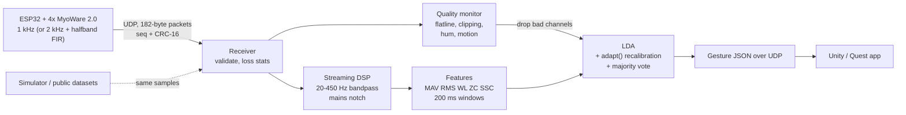

# myobridge

[](https://github.com/ethsanders/myobridge/actions/workflows/ci.yml)

**An open EMG gesture pipeline, from an ESP32 forearm band to a game engine,
benchmarked on public data with honest splits.**

myobridge streams surface EMG from MyoWare 2.0 sensors on an ESP32 over WiFi,
cleans it in real time, decodes hand and wrist gestures with a small linear
classifier, and sends them to Unity or a Quest headset. Around that core it
answers the questions that decide whether a wearable like this works in
practice, each with a measured number:

- **How fast does a gesture model go stale across days, and how little new
  data brings it back?**
- **What happens with a new person?**
- **What does using only 4 sensors cost?**
- **What happens when an electrode falls off mid-session?**
- **Does sampling at 1 kHz behind the MyoWare's gentle filter alias?**

## Results

Measured on two public datasets: 3DC (22 people, 10 channels, 1 kHz) and
MultiDay (1 person, 121 days, 4 channels). Splits are by recording, day or
person; every setting was chosen on separate validation days or people
([DATASETS.md](docs/DATASETS.md)). Brackets are 95% bootstrap intervals.
All 11 gestures; chance is 9%.

| Question | Result |
|---|---|
| Same person, same sitting, 10 channels | **90.6%** [88.5, 92.6] |
| Only 4 channels, spread evenly | **80.8%** [78.2, 83.5] |
| Model from days 1-10, used on days 31-121 | **72.8%** [70.9, 74.6] |
| ... plus 1 s per gesture from that day, with `adapt()` | **86.7%** [85.7, 87.6] (+13.9 points [12.6, 15.4]) |
| New person, no calibration | **34.8%** |
| ... with 2 s per gesture from them | **75.1%** |
| One electrode falls off, no monitor | **32.9%** [31.0, 34.9] |
| ... with the quality monitor dropping it | **89.3%** [88.4, 90.1] (no fault: 90.5%) |
| Folded noise at 1 kHz behind a 1st-order roll-off | +2.9 dB; **+1.0 dB** with the firmware's `OVERSAMPLE 2` |
| Processing time per 20 ms packet | **78 µs** median, 166 µs p99 (0.5% of real time) |


What I took from these, in one line each (details in
[RESULTS.md](docs/RESULTS.md)):

- **Drift across days is the real problem, and it is cheap to fix.** A model
  loses about 7 points within a month and 11 within three. Blending a second
  per gesture of the day's data into the old model (`classifier.adapt`) beats both the old model and
  a model trained on the new data alone at every calibration length.
- **Across people, old data barely helps.** With 2 s per gesture from a new
  person, starting from 21 other people's model adds only 1.1 points
  [0.2, 2.0] over training on their data alone. Plan for calibration.
- **4 sensors cost about 10 points** against 10 around the forearm, for 11
  gestures. Fewer gestures, or careful placement, recover some of it.
- **A dead electrode is catastrophic and easy to catch.** One lifted electrode drops
  accuracy from 90.5% to 32.9% (a clipping one, to 21.9%). The monitor flags
  it within about a second, and switching to a model without that channel
  recovers 89.3% (86.9% for clipping).
- **The EMG doesn't alias; the noise does.** Real forearm EMG typically has under
  0.2% of its power above 512 Hz, so accuracy is unchanged even with no
  anti-aliasing at all. Wideband amplifier noise is another story, which is
  why the firmware can oversample ([ALIASING.md](docs/ALIASING.md)).

Reproduce every number and figure:

```bash
pip install -e ".[dev]"
myobridge fetch     # clones both datasets at pinned commits (~4 GB)
myobridge bench     # writes results/*.json and docs/figures/*.png, ~25 min
```

## How it works



- **Firmware** (`firmware/esp32_emg_streamer/`): a hardware timer wakes a
  FreeRTOS sampler task; a queue hands finished packets to the WiFi sender, so
  a slow send drops a packet visibly instead of disturbing the sample clock.
  The packet format and the optional decimation filter live in plain C++
  headers that CI compiles with g++ and checks bit for bit against the Python.
- **Protocol** ([PROTOCOL.md](docs/PROTOCOL.md)): UDP, a sequence number and
  a CRC-16 per packet. Late data is useless for control, so lost packets are
  counted, not retransmitted.
- **Signal chain**: streaming Butterworth bandpass and mains notch (state
  carried between packets, so chunked output equals one-shot), the Hudgins
  time-domain features, and a from-scratch numpy LDA.
- **Recalibration**: `adapt()` shrinks the stored class means toward the new
  day's and blends the covariance, with two settings chosen on validation
  data. It has a closed form, so it takes about 0.14 ms.
- **Quality monitor** ([SIGNAL_QUALITY.md](docs/SIGNAL_QUALITY.md)): four
  per-channel checks every 250 ms, thresholds set to about 1% false alarms on
  validation people, and a decoder that falls back to models trained without
  the failed channels.

[HOW_IT_WORKS.md](docs/HOW_IT_WORKS.md) walks through every piece and the
reasoning behind it.

## Try it without hardware

```bash
pip install -e .
myobridge demo        # simulate -> packets -> DSP -> features -> LDA, offline
```

The demo exercises the whole chain on a built-in simulator: packet loss and
corruption, calibration, streaming classification and processing time. Its
accuracy only says the plumbing works; the simulator is far cleaner than a
real arm, so the numbers that matter are the ones above.

Live, with a fake armband in one terminal:

```bash
myobridge simulate --port 5005 --drop 0.01            # or the real ESP32
myobridge listen --port 5005                           # live RMS bars, channel health, link stats
myobridge calibrate --seconds 5 --out model.npz        # add --sim to use the simulator directly
myobridge forward --model model.npz --to 127.0.0.1:5006 --verbose
```

Outside North America add `--mains 50`, for example `myobridge listen --mains 50`.

## Hardware

| Part | Notes |
|---|---|
| ESP32 dev board (WROOM-32) | ADC1 pins 32-35 (ADC2 can't be read while WiFi is on) |
| 4x MyoWare 2.0 muscle sensor | The **RAW** output; ENV is pre-smoothed and loses the frequency content the features need |
| Ag/AgCl snap electrodes | Two along each muscle belly, reference on bone |
| LiPo or USB power bank | **Battery only** while electrodes are on (see Safety) |

```bash
cp firmware/esp32_emg_streamer/config.example.h firmware/esp32_emg_streamer/config.h
# set WiFi, your PC's IP, and OVERSAMPLE 1 or 2
arduino-cli compile --fqbn esp32:esp32:esp32 firmware/esp32_emg_streamer
```

The sketch targets Arduino-ESP32 core 3.x. Wiring notes are at the top of
the sketch. [HARDWARE_BRINGUP.md](docs/HARDWARE_BRINGUP.md) is the checklist
for the first sessions on real hardware, including how to measure whether
`OVERSAMPLE 2` lowers the noise floor as predicted.

## Testing

```bash
pytest                    # 170+ tests: DSP, protocol, datasets, splits, benchmarks, firmware
ruff check . && mypy      # lint and strict typing
```

CI runs all of that on Python 3.10-3.13 with a 90% coverage floor, compiles
the firmware for both `OVERSAMPLE` settings, and compiles the firmware
headers with g++ to check them against the Python byte for byte. Tests that
need data run on small fake datasets in the real file formats; the real
datasets are only needed for `myobridge bench`.

## Limitations

- **Not yet measured on my own hardware.** The firmware compiles and its
  logic is tested, but every accuracy number here comes from public datasets
  recorded with other electrodes and amplifiers. Bring-up is next.
- **The MyoWare's upper filter order is an assumption** (first order, from
  its published 20-498 Hz band); the aliasing numbers depend on it.
- **One person for drift.** MultiDay is the best public record of day-to-day
  change I found, but it is one person.
- **Fault tests use injected faults.** Lead-off, hum, motion and clipping are
  simulated on clean recordings, not recorded from real failures.
- **The demo's simulator is not EMG.** It is band-limited noise with made-up
  activation patterns, used only for plumbing tests.

## Docs

| | |
|---|---|
| [RESULTS.md](docs/RESULTS.md) | Every experiment: setup, numbers, what it means |
| [DATASETS.md](docs/DATASETS.md) | The two datasets, citations, and how the splits avoid leakage |
| [ALIASING.md](docs/ALIASING.md) | Does 1 kHz alias? Measured, modelled, and the firmware fix |
| [SIGNAL_QUALITY.md](docs/SIGNAL_QUALITY.md) | The quality monitor, its thresholds and what it buys |
| [HOW_IT_WORKS.md](docs/HOW_IT_WORKS.md) | Every module, the signal chain and the design decisions |
| [PROTOCOL.md](docs/PROTOCOL.md) | Packet format and the gesture JSON for game engines |
| [HARDWARE_BRINGUP.md](docs/HARDWARE_BRINGUP.md) | What to measure first on real hardware |

## Project layout

```text
firmware/esp32_emg_streamer/   sketch, mb_protocol.h, mb_decimator.h, config.example.h
firmware/tests/mb_host.cpp     host build of the headers, used by the tests
src/myobridge/
  protocol.py receiver.py      packets, CRC-16, loss tracking, UDP
  dsp.py features.py           streaming filters, time-domain features
  classifier.py pipeline.py    numpy LDA with adapt(), live pipeline
  quality.py                   per-channel signal-quality checks
  decimator.py aliasing.py     2x decimation reference, noise-folding model
  datasets/ evaluation.py      pinned dataset loaders, leak-free splits, stats
  bench/                       the experiments behind every number and figure
  simulator.py cli.py          fake armband; command-line tools
results/                       benchmark output (JSON, with provenance)
docs/                          the documents above and docs/figures/
tests/
```

## Roadmap

- [ ] Bring-up on my own forearm band, then repeat the drift experiment on it
- [ ] Unity package: UDP listener, gesture events, calibration UI on Quest
- [ ] IMU fusion (wrist orientation alongside EMG)
- [ ] Run the classifier on the ESP32 and send only gestures
- [ ] Own analog front end with a steeper anti-aliasing filter and a 24-bit ADC

## Safety

This is a hobby project, not a medical device. Power the ESP32 and sensors
**only from a battery** whenever electrodes are on skin. Never wear
electrodes while the circuit is connected to mains-powered equipment,
including a charging laptop on the same USB cable used to flash the board.
Flash, unplug, then attach electrodes. Don't place electrodes across the
chest.

## Credits and license

The datasets belong to their authors: 3DC by Côté-Allard et al. and
MultiDay by Kaufmann, Englehart and Platzner, both mirrored by the LibEMG
project. Citations are in [DATASETS.md](docs/DATASETS.md). myobridge
downloads them; it doesn't redistribute them.

MIT, see [LICENSE](LICENSE).
