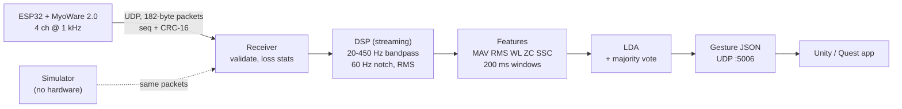
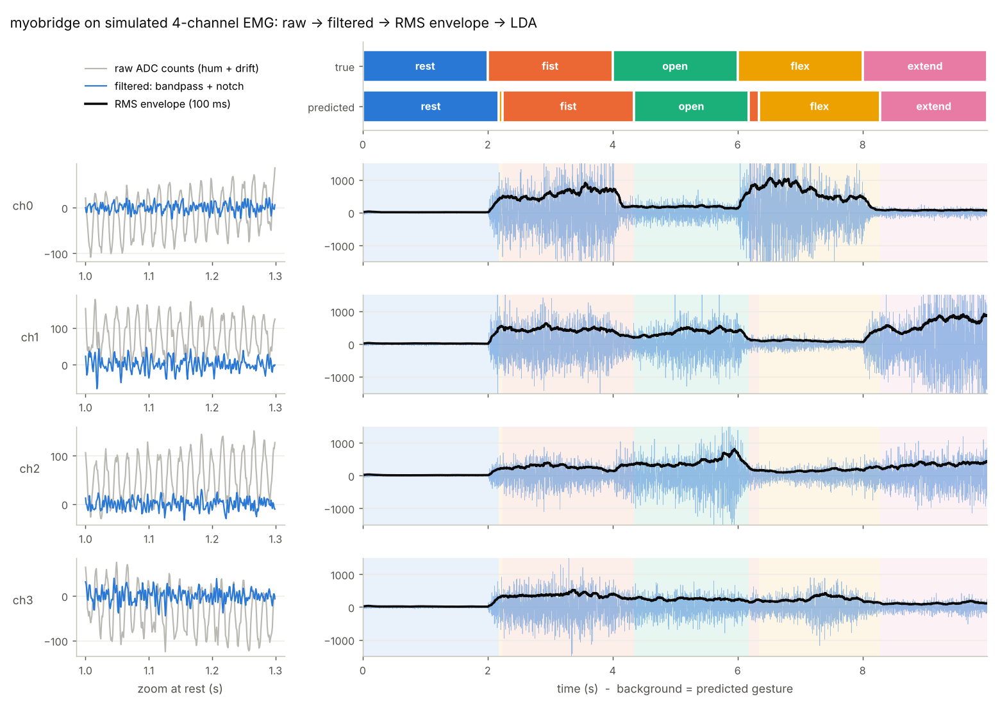

# myobridge

[](https://github.com/ethsanders/myobridge/actions/workflows/ci.yml)

**Stream multi-channel EMG from an ESP32 over UDP, clean it in real time, and turn muscle activity into gestures you can feed to Unity / a Quest headset.**

A small, readable sensor-to-XR bridge: firmware that samples MyoWare 2.0 muscle
sensors at 1 kHz, a tiny CRC-checked UDP protocol, streaming DSP, classic EMG
features, and a from-scratch LDA classifier. A built-in simulator means the
whole pipeline runs (and is tested) without any hardware.





## Quickstart

```bash
git clone https://github.com/ethsanders/myobridge && cd myobridge
pip install -e .            # numpy + scipy only
myobridge demo              # fully offline: simulate -> DSP -> features -> LDA -> evaluate
```

Real output of `myobridge demo` (Python 3.13, Linux container):

```text
myobridge demo: simulated 4-channel EMG, nothing leaves this process

[1/4] Wire protocol: 2000 packets, 1% simulated loss + random bit flips
      received 1986, corrupt 14 (caught by CRC), missing seq numbers 41 (2.02%), reordered 0

[2/4] Calibration: 8 s per gesture (rest, fist, open, flex, extend)
      760 windows x 20 features, LDA training accuracy 100.0%

[3/4] Held-out session (new seed): 3 x 5 gestures, 3 s each, streamed in 20-sample packets
      windows: 897
      accuracy, every window:          94.8%
      accuracy, majority vote (k=5):   92.8%  (steadier output, but lags ~100 ms at each switch)
      accuracy, steady-state windows:  99.8%  (excludes ~300 ms after each switch)

      confusion matrix (rows = true, cols = predicted, every window)
                extend    fist    flex    open    rest
        extend     171       3       6       0       0
          fist       0     173       5       0       2
          flex       0       3     170       7       0
          open       2      11       0     167       0
          rest       8       0       0       0     169

[4/4] Processing latency per 20-sample block (filter+features+LDA+vote)
      mean 126 us, median 99 us, p99 213 us, max 509 us (budget: 20000 us per block)
```

Accuracy is on a *different simulator seed* than training. The misses are
almost all in the ~300 ms after a gesture switch, when a 200 ms window
straddles two gestures. Simulated data is far cleaner than a real forearm, so
expect lower numbers with hardware (see [docs/HOW_IT_WORKS.md](docs/HOW_IT_WORKS.md)).

### Live, with or without hardware

```bash
# terminal 1: a fake armband (or flash the ESP32 and skip this)
myobridge simulate --port 5005 --drop 0.01

# terminal 2: live per-channel RMS bars + packet loss stats
myobridge listen --port 5005

# train a model (from the live stream; add --sim to use the simulator directly)
myobridge calibrate --seconds 5 --out model.npz

# classify live and send gesture JSON to a game engine on :5006
myobridge forward --model model.npz --to 127.0.0.1:5006 --verbose
```

Outside North America, add `--mains 50` before the subcommand
(e.g. `myobridge --mains 50 listen`).

Regenerate the figure with `pip install -e ".[plot]" && python scripts/make_demo_plot.py`.

## Hardware

| Part | Notes |
|---|---|
| ESP32 dev board (WROOM-32) | Any board with ADC1 pins 32-35 broken out |
| 4× MyoWare 2.0 Muscle Sensor | Use the **RAW** output (bandpassed, amplified, centred at Vcc/2). ENV is pre-smoothed and loses the frequency content the features need. |
| Snap electrodes (disposable Ag/AgCl) | 3 per sensor (two on the muscle belly along the fibres, reference on bone) |
| LiPo + charger, or a USB power bank | **Battery only** while electrodes are on (see Safety) |

Wiring, pin choices and the exact core version notes are in the comment block
at the top of [`firmware/esp32_emg_streamer/esp32_emg_streamer.ino`](firmware/esp32_emg_streamer/esp32_emg_streamer.ino).

```bash
cp firmware/esp32_emg_streamer/config.example.h firmware/esp32_emg_streamer/config.h
# edit WiFi SSID/password and your PC's IP, then build with Arduino IDE or:
arduino-cli compile --fqbn esp32:esp32:esp32 firmware/esp32_emg_streamer
```

The sketch targets **Arduino-ESP32 core 3.x** (`timerBegin(frequency)` /
`timerAlarm(...)`; the 2.x timer API won't compile against it).

## Protocol in one paragraph

Each UDP datagram is one packet: a 20-byte little-endian header (`"MB"` magic,
version, channel count, sample rate, u32 sequence number, u64 device timestamp in
µs, frame count), then int16 samples interleaved by frame, then a CRC-16/CCITT-FALSE.
The receiver rejects bad magic/version/length/CRC, and uses sequence numbers
(modulo 2³²) to count dropped, late and duplicated packets and device restarts.
Full spec, plus the gesture JSON format for game engines: [docs/PROTOCOL.md](docs/PROTOCOL.md).

## Design decisions

- **UDP, not TCP.** For live control, a late sample is worthless. TCP would
  retransmit a lost packet and stall everything behind it (head-of-line
  blocking), turning 1 lost packet into a 100+ ms freeze. UDP lets us drop it,
  count it and move on.
- **int16 samples.** The ESP32 ADC is 12-bit, so int16 holds every value with
  room to spare at half the bandwidth of float32, and it's the natural type for
  a future external 16-bit ADC.
- **Sequence numbers.** UDP can drop, duplicate and reorder. A counter in every
  packet is the cheapest way to *measure* link quality (you can't improve what
  you don't measure) and to never feed stale data into the filters.
- **LDA.** The standard baseline in the myoelectric-control literature: closed-form
  training in milliseconds (so recalibrating when electrodes shift is painless),
  prediction is one matrix multiply, works with little data, and is simple
  enough to port to the ESP32 later.
- **Streaming filter state.** Each IIR filter keeps its internal state between
  20-sample packets (`sosfilt` with `zi`), so chunked output is bit-for-bit the
  same as filtering the whole recording (this is tested). Without it every
  packet boundary would inject a transient.
- **Second-order sections.** The 8th-order bandpass is run as cascaded biquads,
  which stays numerically stable where a single high-order polynomial wouldn't.

## Project layout

```text
firmware/esp32_emg_streamer/   ESP32 sketch + config.example.h
src/myobridge/
  protocol.py    packet encode/decode, CRC-16, sequence/loss tracking
  receiver.py    UDP socket -> validated packets + stats
  simulator.py   fake armband: gesture-dependent EMG + hum, drift, noise
  dsp.py         streaming bandpass, notch, rectify, RMS envelope
  features.py    MAV, RMS, waveform length, zero crossings, slope sign changes
  classifier.py  numpy LDA, calibration, majority vote
  pipeline.py    raw blocks -> smoothed gesture predictions
  cli.py         simulate | listen | calibrate | forward | demo
tests/           pytest suite (no hardware, localhost UDP only)
scripts/make_demo_plot.py
docs/            PROTOCOL.md, HOW_IT_WORKS.md, demo.png
```

## Roadmap

- [ ] IMU fusion (wrist orientation from an MPU-6050/BNO085 alongside EMG)
- [ ] Unity package: UDP listener + gesture events + calibration UI on Quest
- [ ] On-device feature extraction (send 20 floats every 50 ms instead of raw samples)
- [ ] Own analog front end PCB (instrumentation amp + 24-bit ADC such as ADS1299)
- [ ] Record real sessions to disk and benchmark against public EMG datasets

## Safety

This is a hobby project, not a medical device. Power the ESP32 and sensors
**only from a battery** (LiPo or USB power bank) whenever electrodes are on
skin. Never wear electrodes while the circuit is connected to mains-powered
equipment, including a laptop that is charging over the same USB cable used to
flash the board. Flash, unplug, then attach electrodes; the data goes over WiFi.
Don't place electrodes across the chest.

## License

MIT, see [LICENSE](LICENSE).
