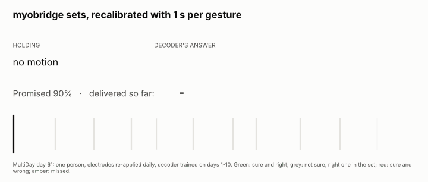

# myobridge

[](https://github.com/ethsanders/myobridge/actions/workflows/ci.yml)
[](https://ethsanders.github.io/myobridge/)
[](https://github.com/ethsanders/myobridge/blob/main/pyproject.toml)
[](https://github.com/ethsanders/myobridge/blob/main/LICENSE)

myobridge decodes hand gestures from forearm EMG in real time. It has three
parts: firmware for an ESP32 that streams four MyoWare 2.0 sensors over WiFi,
a Python library that filters the signal, checks each electrode and runs the
decoder, and a set of benchmarks on public datasets.

The decoder can report a set of gestures instead of a single answer. The set
is calibrated to contain the correct gesture a chosen fraction of the time,
for example 90%, and it grows when the decoder is less certain. I tested this
on MultiDay, a public dataset of one person recorded over 121 days with the
electrodes removed and replaced each day. With the decoder adapted each day
from 1 second per gesture, 90% sets covered the correct gesture 89.1%
[88.7, 89.4] of the time over 91 test days, and between 85.2% and 93.7% on
each day. The single-answer decoder had about the same average accuracy
(89.0%), but its worst day was 75.7%.



The library also includes a signal-quality monitor that detects a lifted or
clipping electrode and switches to a model without it, output to a game
engine over UDP or to Lab Streaming Layer, and tools to record and replay
sessions.

There is a [browser demo](https://ethsanders.github.io/myobridge/demo/) that
runs the library on real recordings. The
[documentation](https://ethsanders.github.io/myobridge/) covers the
[results](https://ethsanders.github.io/myobridge/results/) in full and how to
[build the armband](https://ethsanders.github.io/myobridge/hardware/).

## Quick start

```bash
pip install "myobridge @ git+https://github.com/ethsanders/myobridge"
```

```python
from myobridge import EmgSimulator, GesturePipeline, calibrate

arm = EmgSimulator(seed=0)  # or the real armband, via myobridge.Receiver
model, _, _ = calibrate(arm.record, ["rest", "fist", "open"], seconds=5, fs=arm.fs)
pipeline = GesturePipeline.from_model(model, n_channels=4)

arm.set_gesture("fist")
for prediction in pipeline.process_block(arm.generate(500)):
    print(prediction.gesture, round(prediction.confidence, 2))
```

From the command line, with the armband or the simulator:

```bash
myobridge simulate                    # skip this with the real armband
myobridge listen                      # live signal, channel health and packet loss
myobridge calibrate --out model.npz   # hold each gesture when asked
myobridge forward --model model.npz   # gestures out as JSON over UDP
```

To calibrate gesture sets for yourself, record a session on each of three
days, fit the sets, then run them on any later day:

```bash
myobridge calibrate --out day1-model.npz --session day1.npz   # also day2, day3
myobridge fit day1.npz day2.npz day3.npz --out model.npz
myobridge sets --model model.npz --prompt --web   # scored live, large type in a browser
```

[Getting started](https://ethsanders.github.io/myobridge/getting-started/)
covers more, including decoding a person from a public dataset.
[Calibrating your own sets](https://ethsanders.github.io/myobridge/your-promise/)
explains the three commands above.

## Results

The benchmarks use two public datasets: 3DC (22 people, 10 electrodes) and
MultiDay (one person over 121 days, 4 electrodes). Both have 11 gestures, so
chance is 9%. Settings were chosen on separate validation people or days.
Brackets are 95% confidence intervals.

| Situation | Accuracy |
|---|---|
| Same person, same sitting, 10 electrodes | 92.4% [90.3, 94.4] |
| Same, with 4 electrodes like myobridge | 85.0% [82.8, 87.4] |
| A model from days 1-10, used on days 31-121 | 73.5% [71.8, 75.1] |
| ... after 1 second per gesture of that day's data, with `adapt()` | 89.0% [88.2, 89.7] |
| A new person, no calibration | 39.5% |
| ... with 2 seconds per gesture from them | 77.3% |
| One of 10 electrodes comes off, no quality monitor | 24.4% [22.6, 26.3] |
| ... with the monitor dropping it | 91.2% [90.4, 92.0] |

Day-to-day drift costs more accuracy than anything else measured here.
Blending 1 second per gesture from the new day into the old model recovers
+15.5 points [14.3, 16.7], which is better than retraining on the new data
alone. A new person needs their own calibration: starting from the other 21
people's model adds only 1.5 points [0.0, 3.0] over training on the new
person's 2 seconds per gesture.

At a 90% target, all 91 MultiDay test days had set coverage within 5 points
of 90%, compared with 85.7% of days for the single-answer decoder. A fixed
number of guesses does worse for the same coverage: reaching 95% takes the
top three gestures every time (94.8%), while the sets average 1.95 gestures
(93.9%). The comparison with simpler rules is on the
[conformal page](https://ethsanders.github.io/myobridge/conformal/#against-simpler-rules).
For deciding when to act, plain confidence does as well as the sets, so the
decision gate uses it.

The gate acts on a window only when the top gesture's probability is at
least 0.7, and otherwise repeats the last action. On MultiDay's test days it
made 14.0 wrong actions per minute, against 25.6 for the usual 5-window
majority vote, with no measurable added delay. On 3DC, with the cut-off
chosen the same way, the improvement is smaller: 12.4 to 10.0 after a break.
Details are on the
[decisions page](https://ethsanders.github.io/myobridge/decisions/).

The quality monitor flags a lifted electrode within about a second. The
model without that electrode is computed directly from the full model, so
no retraining is needed.

Processing one 20 ms packet takes 117 µs (median; 550 µs at p99), 1.3% of
real time. The output changes about 220 ms after a gesture starts, mostly
because of the 200 ms window and the 5-window vote. That figure is derived
from the settings rather than measured, and it does not include WiFi
latency.

Sampling at 1 kHz is sufficient for EMG. Wideband amplifier noise above
500 Hz does alias into the band, adding +2.9 dB of noise behind the
sensor's filter at 1 kHz; the firmware's optional 2x oversampling reduces
this to +1.0 dB.

The [results page](https://ethsanders.github.io/myobridge/results/) has
every experiment, including other feature sets and classifiers. Running
`myobridge fetch && myobridge bench` reproduces all of it (about 4 GB of
data and an hour of compute), and a test checks that the numbers in the
docs match the benchmark output.

## Repository layout

- `firmware/`: the ESP32 sketch. A hardware timer drives sampling and a
  queue passes packets to the WiFi sender, so a slow send does not disturb
  the sample clock. Packets carry a sequence number and a CRC-16.
- `src/myobridge/`: the Python package. Streaming filters, 15 features per
  electrode, linear discriminant analysis with one-step recalibration,
  calibrated gesture sets, decision gating, the signal-quality monitor,
  replay of recorded data, and output as UDP JSON or
  [Lab Streaming Layer](https://labstreaminglayer.org).
- `src/myobridge/bench/`: the experiments behind every number, on dataset
  versions pinned to a commit.
- `docs/demo/`: the browser demo, which runs the package in Pyodide.

## Limitations

- I have not yet recorded with my own armband. The firmware compiles and its
  logic is tested, but every accuracy above comes from public datasets
  recorded with other hardware.
  [Bring-up](https://ethsanders.github.io/myobridge/hardware-bringup/) is the
  next step, and
  [the first recorded session](https://ethsanders.github.io/myobridge/first-session/)
  describes the protocol; `myobridge report` turns that session into a
  hardware report.
- Drift is measured on one person, because MultiDay is the best public
  record of day-to-day change I found.
- Electrode faults are simulated on clean recordings rather than recorded.
  A lifted electrode is simulated as a near-flat signal; on a MyoWare it may
  instead float and pick up mains hum.

## Safety

This is a hobby project, not a medical device. Power the armband from a
battery only whenever electrodes are on skin, and never while it is plugged
into anything mains-powered, including a charging laptop.

## Contributing, citing, license

Issues and pull requests are welcome; [CONTRIBUTING.md](https://github.com/ethsanders/myobridge/blob/main/CONTRIBUTING.md)
has the setup. Reports from your own hardware builds are particularly useful.
If you use myobridge in research, please cite it with the metadata in
[CITATION.cff](https://github.com/ethsanders/myobridge/blob/main/CITATION.cff).

MIT licensed. The datasets belong to their authors: 3DC by Côté-Allard et
al. and MultiDay by Kaufmann, Englehart and Platzner, both mirrored by the
[LibEMG](https://github.com/LibEMG) project. myobridge downloads them and
doesn't redistribute them; citations are in
[Datasets](https://ethsanders.github.io/myobridge/datasets/).
