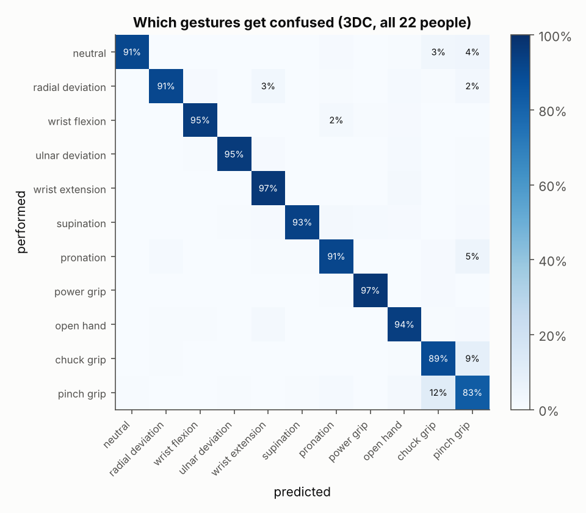
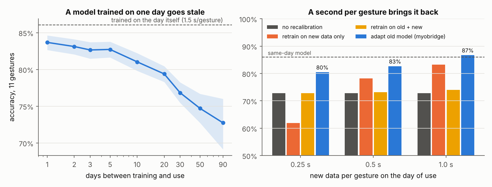
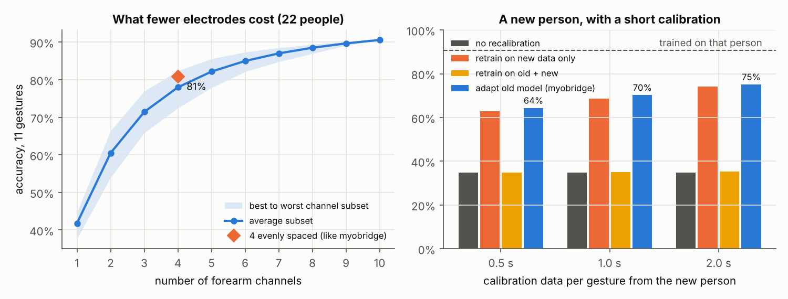
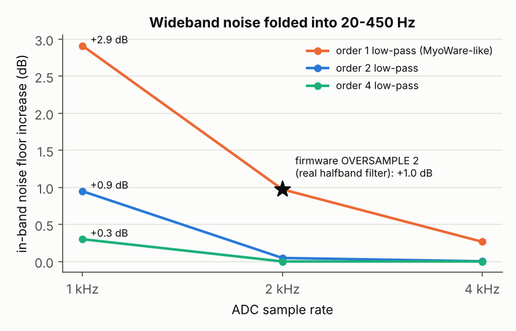
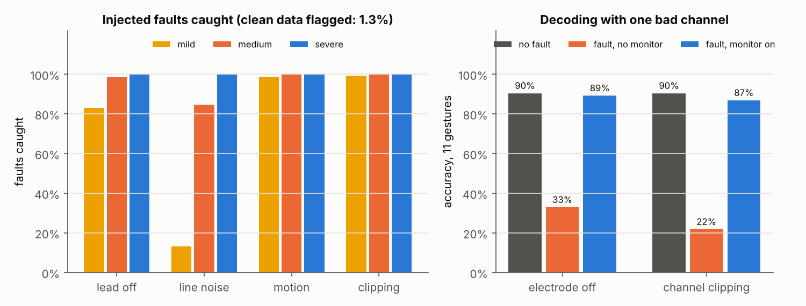

# Results

Every number on this page is read from `results/*.json`, which
`myobridge bench` writes along with the dataset commit and settings that
produced it. `tests/test_docs.py` checks that the headline numbers here and
in the README still match those files. Brackets are 95% bootstrap intervals
of the mean over days or people; "points" are percentage points. All tasks
use 11 gestures, so chance is 9%.

How the data are split, and why it can't leak, is in
[DATASETS.md](DATASETS.md).

## Setup shared by every experiment

- **Signal chain:** 4th-order Butterworth bandpass 20-450 Hz, notch at the
  mains frequency, 200 ms windows every 50 ms, the first 250 ms of each
  recording skipped while the filters settle.
- **Features:** per channel, log mean absolute value, log RMS, log waveform
  length, zero crossings and slope sign changes, with their noise thresholds
  from training-split rest recordings.
- **Classifier:** linear discriminant analysis (`myobridge.classifier`), the
  same code that runs live.

## 1. Within one sitting (3DC)

Per person: train on the 4 cycles before the 5 minute break, test on the 4
after. The armband stays on.

| | Accuracy |
|---|---|
| 22 people, 10 channels | **90.6%** [88.5, 92.6] |
| worst / best person | 77.8% / 97.9% |



**Window length** trades latency for accuracy, but not by much:

| Window | 100 ms | 150 ms | 200 ms | 250 ms | 300 ms |
|---|---|---|---|---|---|
| Accuracy | 88.7% | 89.9% | 90.6% | 91.0% | 91.2% |

## 2. How many channels? (3DC)

The same split, using only *k* of the 10 channels, for every one of the
C(10, *k*) subsets.

| Channels | Mean over all subsets | Fixed choice |
|---|---|---|
| 1 | 41.8% | |
| 2 | 60.5% | |
| 3 | 71.4% | |
| **4** | **78.0%** | **80.8%** [78.2, 83.5] (channels 0, 2, 5, 7) |
| 6 | 85.0% | |
| 8 | 88.5% | |
| 10 | 90.6% | |

The fixed choice, four channels spread evenly around the forearm, was set
before running anything, so it is an unbiased estimate for a 4-sensor band.
The best 4-channel subset reaches 82.4%, but it was picked after seeing test
accuracy, so that number is optimistic and isn't used anywhere.

**Reading:** a 4-sensor band gives up about 10 points against a 10-channel
armband on 11 gestures. Spreading the sensors around the forearm beats a
typical placement by about 3 points.

## 3. Drift across days (MultiDay)

One person, electrodes re-applied each day, 121 day indices. Days 1-10 train
the base model, days 11-30 choose recalibration settings, days 31-121 are
reported.

**How fast a model goes stale.** Train on one whole day, test on a later one:

| Days later | 1 | 2 | 5 | 10 | 20 | 30 | 50 | 90 |
|---|---|---|---|---|---|---|---|---|
| Accuracy | 83.7% | 83.1% | 82.7% | 81.0% | 79.4% | 76.8% | 74.7% | 72.7% |

More training days help (64.4% from 1 day, 72.8% from 10, 80.2% from 30,
tested on days 31-121), but they don't stop the decay.

**Recalibration.** On each test day, a few seconds per gesture of new
labelled data (from 1.0 s into each hold; test windows start at 2.5 s).
Four ways to use it:

- `none`: the base model from days 1-10, unchanged
- `new_only`: a fresh model from the new data alone
- `pooled`: retrain on days 1-10 plus the new data
- `adapt`: `myobridge.classifier.adapt`, which pulls each class mean toward
  the new data's mean and blends in some of its covariance, with two
  settings chosen on days 11-30

| New data per gesture | none | new_only | pooled | **adapt** | adapt − next best |
|---|---|---|---|---|---|
| 0.25 s | 72.8% | 61.9% | 72.8% | **80.5%** | +7.7 [7.0, 8.4] vs none |
| 0.5 s | 72.8% | 78.3% | 73.2% | **82.7%** | +4.4 [3.2, 5.7] vs new_only |
| 1.0 s | 72.8% | 83.3% | 74.0% | **86.7%** | +3.5 [2.6, 4.3] vs new_only |

Intervals on the differences are paired: each method is scored on the same
91 days. For reference, a model trained only on 1.5 s per gesture from the
test day itself, with no older data, scores 86.0%.



**Reading:**

- Pooling barely helps: ten days of old data outvote a second of new data.
- A fresh model needs enough data to estimate its covariance; at 0.25 s per
  gesture it is worse than doing nothing.
- `adapt` keeps the old covariance, which electrode shifts change little, and
  moves the means, which they change a lot. It wins at every length, and with
  1 s per gesture it matches or beats a same-day model trained on more data.

## 4. A new person (3DC)

Leave one person out: train on the other 21, test on the held-out person's
4 cycles after the break. Calibration data come from their first cycle, from 1.0 s
into each 5 s hold. Settings for `adapt` are chosen on people 1-6; people
7-22 are reported.

| New data per gesture | none | new_only | pooled | **adapt** | adapt − new_only |
|---|---|---|---|---|---|
| 0.5 s | 34.8% | 62.9% | 34.9% | **64.4%** | +1.5 [−2.6, 6.1] |
| 1.0 s | 34.8% | 68.7% | 35.1% | **70.3%** | +1.6 [−0.6, 4.1] |
| 2.0 s | 34.8% | 74.0% | 35.4% | **75.1%** | +1.1 [0.2, 2.0] |



**Reading:** other people's data barely transfer (34.8% with no calibration),
and as a prior they add little: the settings chosen on validation people
trust the new person's data almost entirely. Across days, the old model is a
good starting point; across people it isn't. Every new user needs a short
calibration.

## 5. Aliasing (MultiDay + model)

Summarised here, in full in [ALIASING.md](ALIASING.md).

| | |
|---|---|
| Median share of EMG power above 512 Hz | 0.04-0.17% per channel |
| Same-day accuracy at emulated 1024 Hz, steep anti-alias filter | 86.8% |
| ... with no anti-alias filter at all | 86.8% |
| Folded white noise at 1 kHz behind a 1st-order roll-off at 498 Hz | +2.9 dB |
| ... at 2 kHz with the firmware's 47-tap halfband decimator | +1.0 dB |



## 6. Signal quality (3DC)

Summarised here, in full in [SIGNAL_QUALITY.md](SIGNAL_QUALITY.md).

Thresholds are set for about 1% false alarms per check on clean data from
people 1-6; people 7-22 are reported.

| | |
|---|---|
| Clean channel reports raising any check | 1.3% |
| Lifted electrode (signal x0.03) caught | 98.7%, median 1.0 s after onset |
| Mains hum at the EMG's power caught | 84.7% |

One channel broken for the whole test session (16 people x 10 channels):

| Fault | No fault | No monitor | **Monitor** | Always drop the broken channel |
|---|---|---|---|---|
| Electrode off | 90.5% | 32.9% | **89.3%** [88.4, 90.1] | 89.6% |
| Clipping | 90.5% | 21.9% | **86.9%** [86.0, 87.8] | 89.6% |
| Mains hum | 90.5% | 90.5% | **90.3%** | 89.6% |
| Motion | 90.5% | 90.5% | **90.2%** | 89.6% |

**Reading:** a dead or clipping channel wrecks the classifier and the monitor
gets nearly all of it back. Hum and motion don't hurt, because the filters
remove them, so the decoder only drops a channel for flatline or clipping.
That policy was chosen after a first run; SIGNAL_QUALITY.md reports both.



## 7. Speed

Measured by `myobridge bench latency` on the machine that produced the
results file (its CPU is recorded there), with the live code path: 4
channels, 20-sample packets, 200 ms windows every 50 ms, a 5-window vote.

| | |
|---|---|
| Processing per 20 ms packet (filter, features, LDA, vote) | 78 µs median, 166 µs p99 |
| Share of real time used | 0.5% |
| `adapt()` recalibration, 11 gestures | 0.14 ms |

Processing is not where the delay is. The time from starting a gesture to
the smoothed output switching is set by the settings: up to 20 ms to fill a
packet, about 100 ms until the window is mostly the new gesture, and about
100 ms for the majority vote, so roughly 220 ms before network and muscle
onset. That is an estimate from the settings, not a measurement; the knobs
are the window length, the step and the vote size.

## Reproduce

```bash
pip install -e ".[dev]"
myobridge fetch
myobridge bench                     # everything, then the figures
myobridge bench multiday aliasing   # or any subset
```

The benchmarks are deterministic: the same code and dataset commits give
the same JSON.
