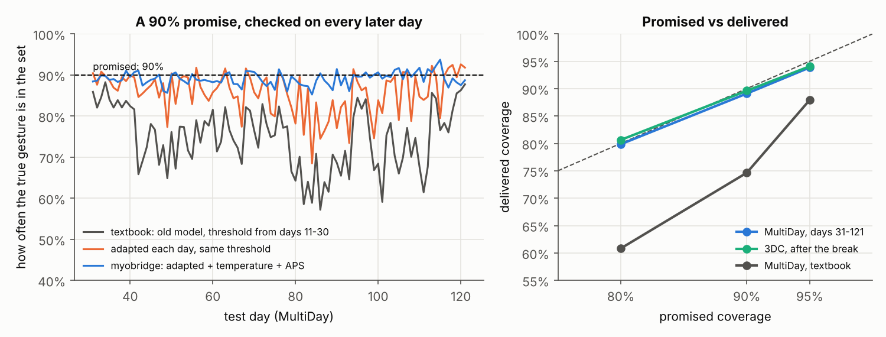

# Conformal gesture sets

A gesture decoder always names a gesture, even when the person is halfway
between two gestures, the armband has slipped, or an electrode has come off.
In a prosthesis, a game or a robot arm, a confident wrong answer does more
harm than no answer. `myobridge.conformal` gives each window a *set* of
gestures instead of one, together with a coverage rate that these pages call
the promise: the true gesture is in the set 90% of the time, or at whatever
rate you choose. A set with one gesture means the decoder is sure. A set with
two or three means it cannot tell them apart, and an application can hold its
last output instead of guessing.

The sets come from split conformal prediction, a standard method that works
with any classifier. Its guarantee holds only when new data look like the
calibration data, and EMG violates that each time the armband is put back on.
This page describes what goes wrong across days and people, and a
calibration recipe that keeps the promise on 91 later days.

## Usage

```python
from myobridge import ConformalGestures, GesturePipeline
from myobridge.classifier import adapt
from myobridge.conformal import temperature_for

# Once, from held-out recordings the model did not train on:
temperature = temperature_for(model, X_held_out_a, y_held_out_a)
sets = ConformalGestures.calibrate(
    model, X_held_out_b, y_held_out_b, alpha=0.1, temperature=temperature
)

# Each day: a second per gesture to recalibrate, and keep the same thresholds
today = adapt(model, X_today, y_today, mean_prior=20, covariance_weight=0.5)
pipeline = GesturePipeline.from_model(today, n_channels=4, conformal=sets)

for p in pipeline.process_block(block):
    if p.sure:
        act_on(p.gesture)        # the set holds exactly one gesture
    else:
        print("not sure:", p.gesture_set)
```

`sets.save(path)` and `ConformalGestures.load(path, model)` store the
thresholds next to a model. When the quality monitor drops a channel, the
pipeline keeps the same thresholds on the smaller model.

## What goes wrong

All results on this page come from `myobridge bench conformal` and are stored
in `results/conformal.json`. The MultiDay splits are the same as on the
[results page](results.md#4-drift-across-days-multiday): days 1-10 train the
model, days 11-20 fit the temperature, days 21-30 set the threshold, and the
promise is checked on each of days 31-121. Numbers in brackets are 95%
bootstrap intervals over days.

The textbook version fails across days. It calibrates the day 1-10 model on
days 11-30 with the usual score, one minus the probability of the true
gesture. With a 90% promise, the true gesture is in the set on later days
only **74.6%** [73.0, 76.2] of the time. The model has drifted, and the
threshold was set for the model as it behaved on the calibration days.

Daily recalibration alone is not enough. With `adapt()` and one second per
gesture on each test day, the same textbook threshold gives **85.7%**. The
adapted model is much more accurate, but its probabilities are nearly always
0 or 1, because an LDA on 60 features is very confident. The threshold then
falls on one of those extremes, and the sets cannot grow when they need to.

Calibrating on the test day itself also fails. Setting each day's threshold
from that day's own recalibration windows gives 79.1%, because the start of
a hold is easier to classify than the rest of it.

## Calibration recipe

1. Recalibrate the model each day with `adapt()` and about one second per
   gesture ([Vidovic et al. 2016](how-it-works.md)).
2. Fit one temperature on adapted held-out days (`temperature_for`) and
   divide the scores by it. This is temperature scaling (Guo et al. 2017);
   here the temperature is about 10.
3. Use the randomized adaptive prediction sets score (APS; Romano, Sesia &
   Candès 2020), with its threshold taken from other adapted held-out days
   (`ConformalGestures.calibrate`).
4. Keep that threshold fixed. Apart from the `adapt()` step, nothing is
   fitted on the test days.

| Promised | Delivered on days 31-121 | Average set size | One-gesture sets | Right when one gesture |
|---|---|---|---|---|
| 95% | 93.9% [93.6, 94.1] | 1.95 | 43.4% | 98.2% |
| **90%** | **89.1% [88.7, 89.4]** | **1.43** | **61.1%** | **97.0%** |
| 80% | 79.9% [79.4, 80.3] | 1.07 | 72.0% | 94.6% |

At 90%, all 91 test days are within 5 points of the promise. The first,
middle and last thirds of the test days deliver 88.9%, 88.5% and 89.8%, so
the threshold does not go stale over three months. The least-covered gesture
gets 81.6%. The `mondrian=True` option sets a separate threshold for each
gesture and raises that to 86.1%. The adapted decoder's plain accuracy on
these days is 89.0%, so on average the 90% sets contain the true gesture
about as often as the decoder's single guess is right. The two differ on
single days: the plain decoder ranges from 75.7% to 94.2%, and the sets from
85.2% to 93.7%.



Removing any step lowers coverage. Without step 1 (temperature and APS on
the unadapted model), the 90% promise delivers 84.1%. Without steps 2 and 3,
it is the recalibration-only result above. With the temperature but the
textbook score, it delivers 86.7%. Swapping the held-out days that fit the
temperature with those that set the threshold gives 89.8%, so the result
does not depend on one favourable split. The APS score has a random
component; over five seeds the 90% row ranges from 88.9% to 89.8%.

## Against simpler rules

`myobridge bench conformal` also runs four simpler rules on the same
adapted, temperature-scaled model and the same days.

| At each promise | Days 31-121 | Worst day | Days within 5 points | Gestures named |
|---|---|---|---|---|
| Plain decoder (one guess) | 89.0% | 75.7% | 86% of days at 90% | 1 |
| Fixed top-k, k set on days 21-30, 95% | 94.8% | 92.7% | all | 3 |
| Sets, 95% | 93.9% [93.6, 94.1] | 91.0% | all | 1.95 |
| Sets, 90% | 89.1% [88.7, 89.4] | 85.2% | all | 1.43 |

A fixed number of guesses is either too few or too many. For 90%, the
calibration days choose one guess, which is the plain decoder with its bad
days. For 95%, they choose three guesses for every window, while the sets
average 1.95 gestures for 0.9 points less coverage.

The one-gesture sets are often used to act only when the decoder is
confident, and plain confidence does that as well or better. If windows are
ranked by top probability and the same 61.0% of them are answered as with
the 90% sets, those answers are right 97.9% of the time, against 97.0% for
the one-gesture sets. With the confidence cut-off taken from days 21-30
instead, it answers 57.8% of windows and is right 98.1% of the time.

A confidence cut-off set to reach a given accuracy does not keep that
accuracy on later days. Set on days 21-30 to be right 95% of the time when
it answers, it is right 93.0% of the time on average over the test days, and
78.5% on the worst day. Only 60% of days fall within 2 points of the target.

The sets are therefore not a better way to select the confident decisions.
What they add is a promise on how often the right gesture is kept, and on
these test days it holds day by day.

The recipe was chosen on validation days alone. With the temperature fitted
on days 11-15 and the threshold on days 16-20, and coverage checked on days
21-30, the recipe is the only variant at 90% that stays within 5 points on
every one of those days (90.9% overall).

`myobridge fit` calibrates from three sessions: one to train, one for the
temperature and one for the threshold. The benchmark repeats this on every
run of three consecutive days within days 1-30 (28 runs) and checks each run
on days 31-121. At 90% the runs deliver 88.5% on average (85.6% to 91.7%),
64% of runs are within 2 points, and the worst single day across all runs is
78.0%. Three days of data give a usable promise, but a looser one than
thirty days.

## The same recipe on other data

### A new sitting (3DC)

The test group is 16 people (people 7-22; people 1-6 were used to choose
settings). Each person's threshold comes from blocked out-of-fold scores
recorded before a 5 minute break, and coverage is checked after the break.
At 90% the sets deliver 89.6% [87.4, 91.1], with 1.27 gestures per set on
average and 69.6% one-gesture sets, which are right 97.3% of the time. At
95% and 80% they deliver 94.1% and 80.6%. Without the temperature, the
textbook score gives 86.2% and APS gives 88.7%.

### A new person (3DC)

Each person is left out in turn, and their threshold comes from the other
people.

- With no calibration data from the new person, the decoder is right 39.5%
  of the time. The sets reflect this: the promise holds (89.8%) because the
  sets include 5.8 of the 11 gestures on average.
- With 2 seconds per gesture and `adapt()`, the sets deliver
  89.3% [85.4, 92.4], with 2.2 gestures per set and 42.3% one-gesture sets,
  which are right 91.0% of the time.
- The textbook score on the adapted model fails at 90% and 95%. Its
  threshold rounds to 1, so every set holds all 11 gestures.

### An electrode fails (3DC)

Each of the four evenly spaced channels fails in turn for each of the 16
people, for the whole session after the break, using the simulated faults
from the [signal quality page](signal-quality.md). At 90%:

| Fault | No quality monitor | With the monitor |
|---|---|---|
| Electrode comes off | 22.8% [19.7, 25.9] | 89.5% [88.5, 90.4] |
| Clipping | 17.2% | 87.2% |
| Mains hum | 89.6% | 89.5% |
| Motion | 89.6% | 89.6% |

An electrode coming off is the case that matters most. Without the monitor,
79.2% of the sets still hold a single gesture, and those are right 24.5% of
the time. Conformal sets do not detect a broken electrode, because the
scores remain as confident as before. The quality monitor has to detect the
fault and drop the channel. The "with the monitor" column refits the
threshold for the model without that channel. `GesturePipeline` does not
refit: it keeps the full model's threshold, which delivers
90.2% [89.2, 91.1] with an electrode off (1.38 gestures per set). No
refitting is needed when an electrode fails.

The [live demo](demo/index.html) replays these results on four MultiDay
days, and the page can switch to the textbook recipe or simulate an
electrode failure.

## Caveats

- Across days, the promise is measured, not guaranteed. The guarantee in
  conformal prediction assumes new windows are exchangeable with the
  calibration windows. Days are not exchangeable, and this page exists
  because of that. The recipe holds for one person over 91 days and for 16
  people across a break. A new person, armband or task should be checked
  again.
- MultiDay is one person, so the across-day result describes one person.
- Recalibration and testing share each hold. Each MultiDay test day is
  recalibrated on seconds 1-2 of each hold and scored from second 2.5 of the
  same holds. The thresholds come from other days, but the adapted model has
  seen the start of every contraction it is tested on. The 3DC sitting check
  above has no such overlap: its threshold is set before a break and checked
  on new contractions after it.
- The end of a hold is harder to classify. In MultiDay, the last second of
  each hold is 26.8% of the test windows, and the adapted decoder is 96.7%
  accurate without those windows, against 89.0% with them. With those
  windows removed from the test days only, the 90% sets over-deliver
  (94.1%). With them removed from every step, the recipe delivers 89.7%. In
  neither case is the promise broken, but where the hard windows fall
  affects the result, and live use will have its own pattern.
- Coverage is per window, not per decision. The pipeline's majority vote
  smooths the gesture it reports, but `gesture_set` belongs to the newest
  window. [Decision policies](decisions.md) measures what sets do for decisions,
  and a plain confidence cut-off does more there.
- Cost: two values are fitted, one temperature and one threshold, and both
  fits are instant. Prediction adds a sort of 11 numbers per window.

## Related work

Rejecting uncertain EMG decisions is an established idea. Scheme, Hudgins &
Englehart (IEEE TBME 2013) reject decisions with low confidence, and later
work learns rejection rules or uncertainty estimates. These approaches set a
confidence cut-off by hand and do not state how often the right gesture will
be kept. Conformal prediction (Vovk, Gammerman & Shafer 2005), APS (Romano,
Sesia & Candès 2020) and adaptive conformal inference (Gibbs & Candès 2021)
are standard methods. Adaptive conformal inference is in the module as
`AdaptiveAlpha`. In the benchmark it underdelivers (85.3% at 90%), because
the only feedback available on a test day comes from the easier start of
each hold. I have not found a study of conformal gesture sets for EMG across
days, but I may have missed one. If you know of one, please open an issue.
