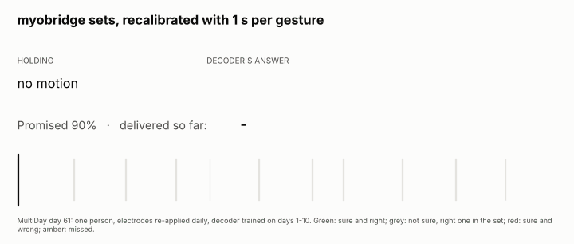
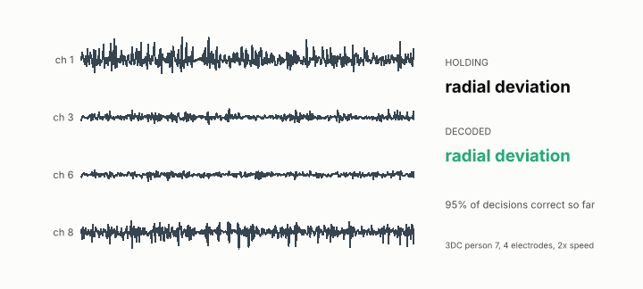

# myobridge

myobridge decodes hand gestures from forearm EMG in real time, using four
sensors on an ESP32 that stream over WiFi and a Python library that filters
the signal and runs the decoder.

The decoder can report a set of gestures calibrated to contain the correct
one 90% of the time. On one person recorded over months, with the electrodes
replaced each day, the sets covered the correct gesture 89.1% of the time
overall and at least 85.2% on each of 91 later days. The single-answer
decoder's worst day was 75.7% ([method and comparisons](conformal.md)).



The firmware samples at 1 kHz and sends 20-sample packets. The library
processes each packet in about a tenth of a millisecond. The benchmarks on
public datasets measure accuracy across days and people, and what happens
when an electrode fails.



*Person 7 of the 3DC dataset, four electrodes, decoded by the same code that
runs live. Halfway through, one electrode is pulled off in software; the
quality monitor drops it and the decoder keeps going on the other three.*

<div class="grid cards" markdown>

- **[Try the live demo](demo/index.html)**

    Real recordings decoded in the browser. You can disconnect an electrode
    and see how the decoder and the sets respond.

- **[Get started](getting-started.md)**

    Installation, then decoding the simulator, a public dataset, or your own
    armband.

- **[Build the armband](hardware.md)**

    Parts list (four MyoWare sensors, an ESP32, a battery), wiring, firmware
    and first checks.

- **[See the results](results.md)**

    Accuracy across days, people and electrode counts, the effect of one
    second of recalibration, and the cost of a loose electrode.

</div>

## Contents

- Firmware for the ESP32. A timer drives the sampler, and a queue passes
  packets to the WiFi sender so slow sends do not disturb the sample clock.
  Optional 2x oversampling uses a halfband filter.
- A streaming pipeline: band-pass and mains notch filters that keep their
  state between packets, 15 features per channel, LDA, and majority voting.
- Recalibration with `adapt()`. One second per gesture from a new day
  recovers most of the accuracy a model loses to drift.
- Calibrated gesture sets that contain the correct gesture a chosen share of
  the time, and keep doing so across days after recalibration
  ([details](conformal.md)).
- Decision policies that act only on confident windows and otherwise repeat
  the last action, evaluated in wrong actions per minute
  ([details](decisions.md)).
- A signal-quality monitor that detects a lifted or clipping electrode
  within about a second and switches to a model without it.
- Benchmarks on two public datasets, split by recording, day and person,
  with settings chosen on validation data. The test suite checks every
  number in the docs against the benchmark output.

```python
from myobridge import EmgSimulator, GesturePipeline, calibrate

arm = EmgSimulator(seed=0)
model, _, _ = calibrate(arm.record, ["rest", "fist", "open"], seconds=5, fs=arm.fs)
pipeline = GesturePipeline.from_model(model, n_channels=4)
for prediction in pipeline.process_block(arm.generate(20)):
    print(prediction.gesture, prediction.confidence)
```

## Status

The library, firmware and benchmarks are tested. Every accuracy number so
far comes from public datasets recorded with other hardware. The next step
is recording with the myobridge armband itself, following
[the bring-up checklist](hardware-bringup.md).
