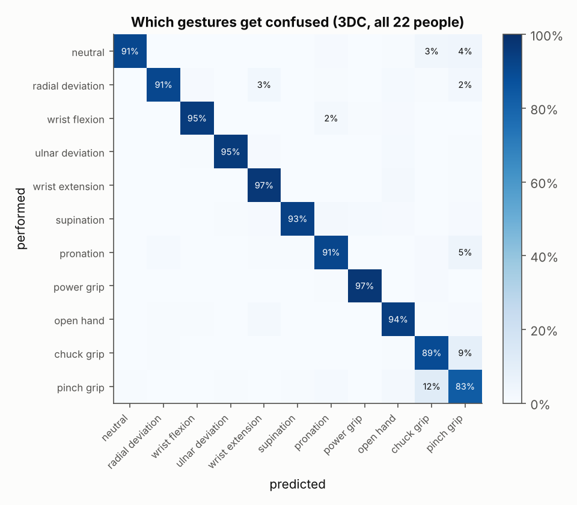
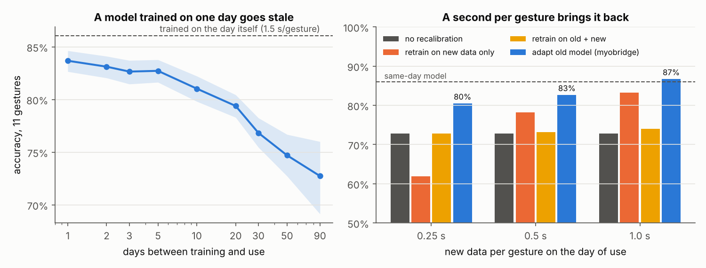
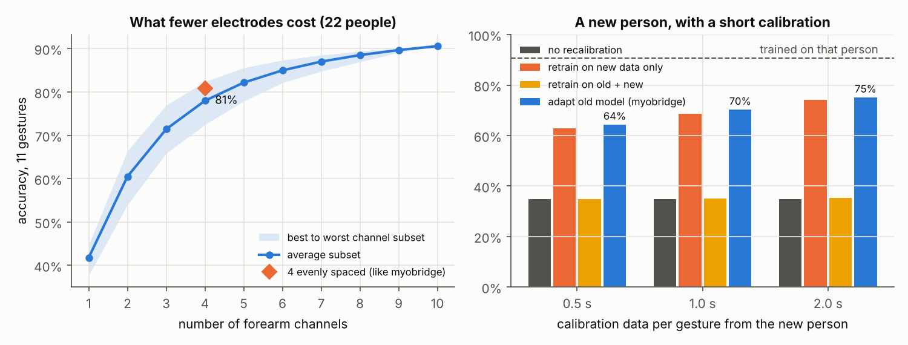
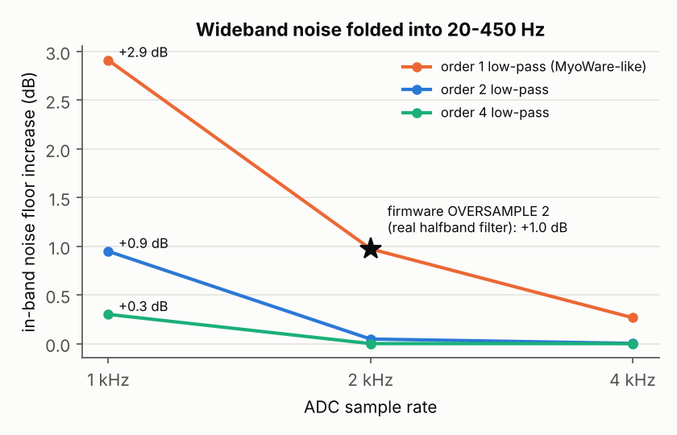
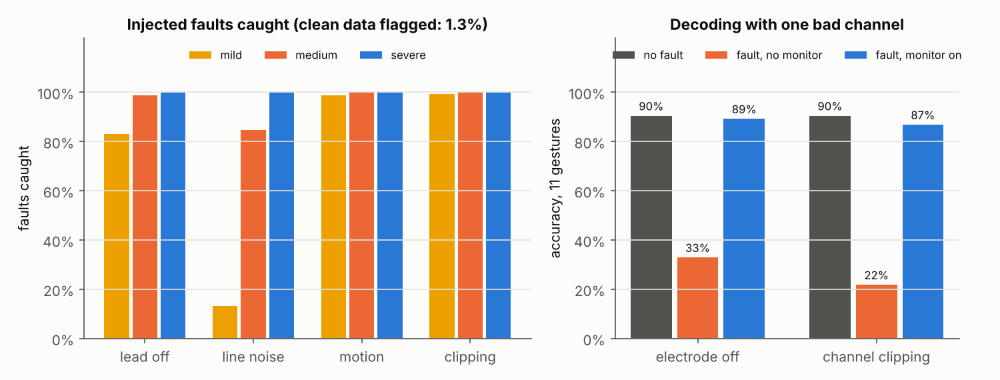

# Results

The numbers on this page are read from `results/*.json`. `myobridge bench`
writes those files together with the dataset commit and settings that
produced them, and `tests/test_docs.py` checks that the headline numbers
here and in the README still match. Brackets are 95% bootstrap intervals of
the mean over days or people, and "points" are percentage points. All tasks
use 11 gestures, so chance is 9%.

[datasets.md](datasets.md) describes how the data are split and why test
data cannot leak into training.

## Common setup

- **Signal chain:** 4th-order Butterworth bandpass 20-450 Hz, notch at the
  mains frequency, 200 ms windows every 50 ms. The first 250 ms of each
  recording is skipped while the filters settle.
- **Features:** 15 per channel, the `td-ar-psd` set: log mean absolute
  value, log RMS, log waveform length, zero crossings and slope sign changes
  (noise thresholds from training-split rest recordings), four
  autoregressive coefficients, and the six TD-PSD spectral-moment features
  of Al-Timemy et al. (2016). Section 3 shows how this set was chosen.
- **Classifier:** linear discriminant analysis (`myobridge.classifier`), the
  same code that runs live. Its ridge is scaled to each feature's own
  variance, so the model does not depend on the units of a feature.

## 1. Within one sitting (3DC)

For each person, the model is trained on the 4 cycles before the 5 minute
break and tested on the 4 cycles after it. The armband stays on throughout.

| | Accuracy |
|---|---|
| 22 people, 10 channels | **92.4%** [90.3, 94.4] |
| worst / best person | 77.4% / 98.5% |



Window length trades latency for accuracy, but the effect is small:

| Window | 100 ms | 150 ms | 200 ms | 250 ms | 300 ms |
|---|---|---|---|---|---|
| Accuracy | 90.3% | 91.6% | 92.4% | 92.9% | 93.3% |

## 2. Number of channels (3DC)

This uses the same split with only *k* of the 10 channels, evaluated on
every one of the C(10, *k*) subsets.

| Channels | Mean over all subsets | Fixed choice |
|---|---|---|
| 1 | 50.1% | |
| 2 | 68.7% | |
| 3 | 78.0% | |
| **4** | **83.2%** | **85.0%** [82.8, 87.4] (channels 0, 2, 5, 7) |
| 6 | 88.4% | |
| 8 | 90.9% | |
| 10 | 92.4% | |

The fixed choice is four channels spaced evenly around the forearm. It was
set before any run, so it gives an unbiased estimate for a 4-sensor band.
The best 4-channel subset reaches 86.1%, but it was picked after seeing test
accuracy, so that number is optimistic and is not used anywhere.

With 11 gestures, a 4-sensor band loses about 7 points against the
10-channel armband. Even spacing gains about 2 points over the average
placement.

## 3. Feature set and classifier (3DC, MultiDay)

**Features.** The original decoder used only the five time-domain features.
The decision to add autoregressive and spectral-moment features was made on
validation data only: 3DC people 1-6 and MultiDay days 11-30. The tables
show validation first, then the reported people and days, which were
examined only after the choice.

| 3DC, within one sitting | `td` (5 per channel) | `td-ar-psd` (15) | Difference |
|---|---|---|---|
| Validation, people 1-6, 10 channels | 91.6% | 92.9% | |
| Validation, people 1-6, even 4 | 81.5% | 83.1% | |
| Reported, people 7-22, 10 channels | 91.2% | 92.2% | +1.0 [0.6, 1.4] |
| Reported, people 7-22, even 4 | 83.6% | 85.7% | +2.1 [1.4, 2.7] |

| MultiDay, base model from days 1-10 | `td` | `td-ar-psd` | Difference |
|---|---|---|---|
| Validation days 11-30, no recalibration | 87.0% | 89.5% | |
| Validation days 11-30, `adapt` with 1 s | 90.7% | 92.0% | |
| Test days 31-121, no recalibration | 70.4% | 73.5% | +3.1 [2.5, 3.7] |
| Test days 31-121, `adapt` with 1 s | 87.1% | 89.0% | +1.9 [1.6, 2.3] |

The gain is largest with fewer channels and on later days, where accuracy
is lowest. The 3DC rows for people 7-22 differ from section 1, which
averages all 22 people.

The per-feature ridge was added in the same change. It fixed a real
problem: with mixed feature scales, one fixed ridge over-regularised some
features and under-regularised others. On MultiDay, however, it also
lowered the old `td` features' no-recalibration test score from 72.8% to
70.4%, so part of the gap in that row comes from the ridge treating `td`
slightly worse. With `adapt`, which is the comparison that matters in
practice, both feature sets gain.

**Classifier.** LDA was compared with three standard scikit-learn
classifiers on the same features and people 7-22. Their settings were fixed
before the run and not tuned: an RBF SVM (standardised features, C = 10), a
random forest (200 trees) and a one-hidden-layer MLP (128 units,
standardised features).

| | LDA | SVM (RBF) | Random forest | MLP |
|---|---|---|---|---|
| Accuracy | **92.2%** | 89.8% | 85.8% | 89.9% |
| LDA minus this | | +2.4 [1.4, 3.2] | +6.4 [4.7, 8.4] | +2.3 [1.5, 3.0] |

With a few minutes of data per person, LDA is the most accurate of the
four. It is also the only one with a closed-form recalibration (section 4),
and it trains in milliseconds and runs in microseconds. Tuned SVMs and MLPs
may close the gap; these untuned ones do not.

## 4. Drift across days (MultiDay)

MultiDay has one person over 121 day indices, with the electrodes
re-applied each day. Days 1-10 train the base model, days 11-30 are used to
choose recalibration settings, and days 31-121 are reported.

To measure how quickly a model goes stale, it is trained on one whole day
and tested on a later one:

| Days later | 1 | 2 | 5 | 10 | 20 | 30 | 50 | 90 |
|---|---|---|---|---|---|---|---|---|
| Accuracy | 86.5% | 86.0% | 85.4% | 84.1% | 82.4% | 79.7% | 76.7% | 73.8% |

More training days help (70.5% from 1 day, 73.5% from 10, 82.1% from 30,
tested on days 31-121), but they do not stop the decay.

For recalibration, each test day supplies a few seconds of new labelled
data per gesture, taken from 1.0 s into each hold. Test windows start at
2.5 s. Four methods use this data:

- `none`: the base model from days 1-10, unchanged.
- `new_only`: a fresh model from the new data alone.
- `pooled`: retrain on days 1-10 plus the new data.
- `adapt`: `myobridge.classifier.adapt`, which pulls each class mean toward
  the new data's mean and blends in some of its covariance, with two
  settings chosen on days 11-30. This is the supervised adaptation of
  Vidovic et al. (*IEEE TNSRE* 24(9):961-970, 2016); myobridge only states
  the mean's weight as a number of windows.

| New data per gesture | none | new_only | pooled | **adapt** | adapt − next best |
|---|---|---|---|---|---|
| 0.25 s | 73.5% | 61.9% | 73.6% | **82.2%** | +8.6 [7.9, 9.3] vs pooled |
| 0.5 s | 73.5% | 78.4% | 74.3% | **85.2%** | +6.8 [5.4, 8.1] vs new_only |
| 1.0 s | 73.5% | 85.8% | 75.6% | **89.0%** | +3.2 [2.5, 3.9] vs new_only |

Intervals on the differences are paired: each method is scored on the same
91 days. For reference, a model trained only on 1.5 s per gesture from the
test day itself, with no older data, scores 87.9%.



Pooling barely helps, because ten days of old data outweigh a second of new
data. A fresh model needs enough data to estimate its covariance, and at
0.25 s per gesture it is worse than no recalibration. `adapt` keeps the old
covariance, which electrode shifts change little, and moves the class
means, which they change a lot. It is the best method at every calibration
length, and with 1 s per gesture it beats a same-day model trained on more
data.

A daily calibration that asked only for rest would be much easier for a
user, so I tested whether rest alone is enough. It is not. Moving every
class mean by the shift that rest shows recovers 3.1 points [2.5, 3.7] with
1 s of rest, against 15.5 for `adapt()` with every gesture. Adding two more
gestures (key grip and index point, chosen on days 11-30) and giving those
their own new means reaches 82.4%. A single shift estimated from all 11
gestures reaches only 80.0%. One shared shift explains 21.3% [20.1, 22.5]
of how the class means move from day to day, so most of the drift is
specific to each gesture. These numbers come from
`myobridge bench partial_calibration` and are stored in
`results/partial_calibration.json`.

Most of the adapted model's errors occur at the end of a hold. The last
second of each hold is 26.8% of the test windows. Without those windows,
the adapted model scores 96.7% and the base model 77.4%. The headline
numbers keep them, because a live user's holds also end.

## 5. A new person (3DC)

Each person is held out in turn. The model is trained on the other 21 and
tested on the held-out person's 4 cycles after the break. Calibration data
come from their first cycle, from 1.0 s into each 5 s hold. Settings for
`adapt` are chosen on people 1-6, and people 7-22 are reported.

| New data per gesture | none | new_only | pooled | **adapt** | adapt − new_only |
|---|---|---|---|---|---|
| 0.5 s | 39.5% | 65.2% | 39.7% | **65.3%** | +0.1 [−3.4, 3.7] |
| 1.0 s | 39.5% | 70.7% | 40.1% | **72.0%** | +1.3 [−0.6, 3.1] |
| 2.0 s | 39.5% | 75.8% | 40.7% | **77.3%** | +1.5 [0.0, 3.0] |



A model trained on other people transfers poorly, as the `none` column
shows. As a prior it adds little: the `adapt` settings chosen on the
validation people give almost all the weight to the new person's data. A
person's own old model is a good starting point on a new day, but a model
from other people is not, so every new user needs a short calibration.

## 6. Aliasing (MultiDay + model)

This is a summary; [aliasing.md](aliasing.md) has the full analysis.

| | |
|---|---|
| Median share of EMG power above 512 Hz | 0.04-0.17% per channel |
| Same-day accuracy at emulated 1024 Hz, steep anti-alias filter | 88.1% |
| ... with no anti-alias filter at all | 88.1% |
| Folded white noise at 1 kHz behind a 1st-order roll-off at 498 Hz | +2.9 dB |
| ... at 2 kHz with the firmware's 47-tap halfband decimator | +1.0 dB |



## 7. Signal quality (3DC)

This is a summary; [signal-quality.md](signal-quality.md) has the full
analysis.

Thresholds are set for about 1% false alarms per check on clean data from
people 1-6, and people 7-22 are reported.

| | |
|---|---|
| Clean channel reports raising any check | 1.3% |
| Lifted electrode (signal x0.03) caught | 98.7%, median 1.0 s after onset |
| Mains hum at the EMG's power caught | 84.7% |

In the next table, one channel is broken for the whole test session, for
each of 16 people x 10 channels:

| Fault | No fault | No monitor | **Monitor** | Always drop the broken channel |
|---|---|---|---|---|
| Electrode off | 92.2% | 24.4% | **91.2%** [90.4, 92.0] | 91.6% |
| Clipping | 92.2% | 17.9% | **88.7%** [87.8, 89.5] | 91.6% |
| Mains hum | 92.2% | 92.2% | **91.9%** | 91.6% |
| Motion | 92.2% | 92.2% | **91.9%** | 91.6% |

A disconnected or clipping channel ruins the classifier's accuracy, and the
monitor recovers nearly all of the loss. Hum and motion do not reduce
accuracy because the filters remove them, so the decoder drops a channel
only for flatline or clipping. That policy was chosen after a first run;
signal-quality.md reports both.



## 8. Conformal prediction sets (MultiDay, 3DC)

This is a summary; [conformal.md](conformal.md) has the full analysis. Here
the decoder outputs a set of gestures that should contain the true gesture
90% of the time. The test is whether that coverage holds on new days, after
a break, for new people and with broken electrodes. Thresholds are always
set on held-out days or people.

| At a 90% promise | Delivered | Gestures per set | Right when the set has one |
|---|---|---|---|
| MultiDay days 31-121, textbook threshold, old model | 74.6% [73.0, 76.2] | 1.03 | 74.4% |
| ... adapted each day, recipe (temperature + APS) | 89.1% [88.7, 89.4] | 1.43 | 97.0% |
| 3DC after the break, recipe | 89.6% [87.4, 91.1] | 1.27 | 97.3% |
| 3DC new person, 2 s per gesture, recipe | 89.3% [85.4, 92.4] | 2.18 | 91.0% |
| 3DC electrode off, with the quality monitor | 89.5% [88.5, 90.4] | 1.34 | 96.7% |
| ... without the monitor | 22.8% [19.7, 25.9] | 1.06 | 24.5% |

The textbook calibration fails once the armband is put back on. The recipe
recalibrates with `adapt()`, softens the LDA's probabilities with one
temperature and uses the APS score. It holds coverage on all 91 test days,
within 5 points on every one. A broken electrode breaks coverage again with
no visible sign, which is why the quality monitor runs first.

## 9. Decision policies (MultiDay, 3DC)

This is a summary; [decisions.md](decisions.md) has the full analysis. A
user experiences the decoder's decisions rather than its individual
windows, so the measure here is how often the output is a wrong gesture.
Holds are played back to back through a decision policy, so every hold
begins as a gesture change. Settings are chosen on validation days and
people, matched to the 5-window vote's speed and time on the right gesture.

| Wrong actions per minute, from 2.5 s | 5-window vote | Best policy chosen on validation | Change |
|---|---|---|---|
| MultiDay days 31-121 | 25.6 | 14.0 (confidence 0.7, latched) | −11.6 [−12.8, −10.6] |
| 3DC after the break | 12.4 | 10.0 (evidence, latched) | −2.4 [−3.8, −1.2] |
| 3DC new person, 2 s per gesture | 33.2 | 27.9 (evidence, latched) | −5.2 [−10.0, −1.1] |

On MultiDay, keeping the last action until a window is confident enough
gives clearly fewer wrong actions at the same speed. The gain on 3DC is
smaller. Acting only on one-gesture conformal sets helps less than a plain
confidence cut-off.

## 10. Speed

`myobridge bench latency` measures these figures with the live code path:
4 channels, 20-sample packets, 200 ms windows every 50 ms, 60 features and
a 5-window vote. The machine's CPU is recorded in the results file.

| | |
|---|---|
| Processing per 20 ms packet (filter, features, LDA, vote) | 117 µs median, 550 µs p99 |
| Share of real time used | 1.3% |
| `adapt()` recalibration, 11 gestures | 0.33 ms |

Processing contributes little to the delay. The time from starting a
gesture to the smoothed output switching is set by the settings: up to
20 ms to fill a packet, about 100 ms until the window is mostly the new
gesture, and about 100 ms for the majority vote. That totals roughly 220 ms
before network delay and muscle onset. This figure is estimated from the
settings and was not measured. The window length, the step and the vote
size control it.

## Reproduce

```bash
pip install -e ".[dev]"
myobridge fetch
myobridge bench                     # everything, then the figures
myobridge bench multiday aliasing   # or any subset
```

The benchmarks are deterministic: the same code and dataset commits give
the same JSON.
