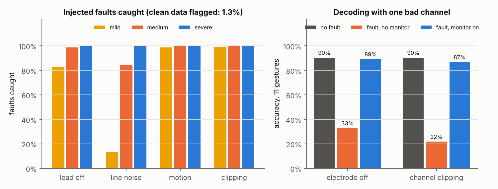

# Signal quality: catching a bad electrode before it ruins the output

A gesture classifier trusts every channel equally. If one electrode lifts
off, saturates, or picks up mains hum, the classifier doesn't know: it just
starts giving wrong answers. On 3DC, one lifted electrode takes accuracy from
92.2% to 24.4%.

`myobridge.quality` checks each channel every 250 ms, says what's wrong in
words a person can act on, and lets the decoder fall back to a model trained
without the bad channel. `myobridge listen` shows the result live.

Every number here is in `results/quality.json`, made by
`myobridge bench quality` on the raw 3DC recordings.

## The four checks

Each check looks at the last 1 s of **raw** samples on one channel.

| Check | Fires when | Usual cause |
|---|---|---|
| `flatline` | 20-450 Hz RMS is below 0.65x that channel's level during the calibration rest | electrode off, lead unplugged |
| `clipping` | more than 1% of samples sit on an ADC rail | gain too high, saturated amplifier |
| `line_noise` | narrow peaks at the mains frequency and its 2nd and 3rd harmonics hold more than 60% of the 20-450 Hz power | mains hum: long leads, a charger nearby, poor reference contact |
| `motion` | more than 25% of the power is below 10 Hz | cables or skin moving |

Two details matter:

- **Flatline is relative to rest, not to zero.** Rest EMG is small but not
  zero, and every channel's resting level differs, so each channel is
  compared with its own level from the calibration rest. That's why
  `listen` asks you to relax for the first 3 seconds. The level is the
  median over 1 s pieces of the rest, so one fidget or noisy second
  doesn't raise it.
- **Line noise counts only the excess.** EMG has real power at 50 or 60 Hz.
  The check estimates the local floor from the spectrum 8-20 Hz either side
  of each mains peak (Welch, 4 Hz bins) and counts only the power above it.
  An earlier version that counted the whole peak called about 17% of the
  power "hum" on perfectly clean EMG.

## How the thresholds were set

Each threshold is the 99th percentile of its statistic on clean data from
people 1-6 (1st percentile for flatline), so each check should fire on about
1% of clean reports. None of the faults below were used to choose them.

| Check | Chosen on people 1-6 | Default in `QualityConfig` |
|---|---|---|
| flatline ratio | 0.636 | 0.65 |
| line noise share | 0.593 | 0.6 |
| motion share | 0.228 | 0.25 |

The defaults are the rounded values, and a test checks they stay within
0.025 of the benchmark's. They were set on the 3DC armband, which has its
own amplifier and filters; the bring-up checklist
([hardware-bringup.md](hardware-bringup.md)) includes checking them on
myobridge's hardware.

## False alarms on clean data (people 7-22)

| | Share of 118,800 channel reports |
|---|---|
| any check | 1.3% |
| flatline | 0.9% |
| motion | 0.4% |
| line noise | 0.07% |
| clipping | 0.0% |

No single person dominates any more. The most-flagged channel raises an
alarm in 65 of its roughly 740 reports (about 9%); before the fix below, the
worst one did in 334.

An earlier version measured the rest level as the RMS of the whole 3 s rest.
On that version, false flatline alarms were 1.5% and the five most-flagged
channels all belonged to person 10, whose rest recordings had noisy
stretches that inflated the level, so ordinary low-effort gestures looked
"flat". Taking the median over 1 s pieces fixed that and also caught more
mild lead-offs (83% against 74%). Those earlier figures are from my run of
the old code and aren't in the results file. Like the drop policy below, this
change came from looking at the reported people; the thresholds themselves
are still set on people 1-6 only.

## Detecting injected faults (people 7-22)

Each fault is injected into one channel of a clean recording from 1.5 s on,
for every channel of every recording (704 cases per level). "Caught" means the
right check fired on that channel after the onset.

| Fault | Mild | Medium | Severe |
|---|---|---|---|
| Electrode off (signal x0.1 / x0.03 / x0.01) | 83.0% | 98.7% | 100% |
| Mains hum (0.25x / 1x / 4x the EMG power) | 13.1% | 84.7% | 100% |
| Motion (baseline wander at 1x / 3x / 10x the EMG RMS) | 98.7% | 100% | 100% |
| Clipping (peak at 1x / 2x / 4x the rail) | 99.4% | 100% | 100% |

Median delay from onset to detection is 1.0 s for an electrode coming off
(the 1 s window has to be mostly faulty), and 0.25-1.0 s for the others at
medium or severe levels. Mild hum, at a quarter of the EMG power, mostly
goes unflagged, which is fine: the notch filter removes it anyway.



## Does acting on it help?

For each of 16 people and each of the 10 channels, that channel is broken
for the whole test session and gestures are decoded three ways:

- **no monitor:** the normal model, bad channel included
- **monitor:** whenever the monitor flags a channel, use a model trained
  without it (`LDAClassifier.subset` drops that channel's feature columns
  and gives exactly the model a refit without them would; models are cached)
- **oracle:** always use the model without the broken channel (the best the
  monitor could do)

| Fault | No fault | No monitor | **Monitor** | Oracle |
|---|---|---|---|---|
| Electrode off (x0.01) | 92.2% | 24.4% | **91.2%** | 91.6% |
| Clipping (peak at 2x the rail) | 92.2% | 17.9% | **88.7%** | 91.6% |
| Mains hum (4x the EMG power) | 92.2% | 92.2% | **91.9%** | 91.6% |
| Motion (3x the EMG RMS) | 92.2% | 92.2% | **91.9%** | 91.6% |

Each cell averages 160 cases (16 people x 10 channels).

**Reading:**

- For a dead or clipping channel, the monitor recovers almost everything.
  Clipping recovers a little less. My reading, which the benchmark doesn't
  isolate: the fault raises the gain, and during quiet gestures the
  over-amplified signal can stay under the rail, so the check doesn't fire
  while the inflated amplitude still misleads the model.
- Hum and motion don't hurt the classifier at all. The mains notch and the
  20 Hz high-pass already remove them, so the channel is still useful.
- False alarms cost a little: with hum or motion, which the classifier
  shrugs off, the monitor scores about 0.3 points below no monitor, because in
  about 4.5% of windows a false alarm (mostly flatline) drops a good
  channel.

### The drop policy, and a decision made after seeing data

The monitor reports all four problems, but the decoder only drops a channel
for **flatline** or **clipping** (`quality.DROP_CHANNEL_ON`). My first version
dropped a channel for any flag. The first full run showed that this made hum
cost about a point instead of almost nothing, for the reason above, so I changed
it.

Because that change was made after looking at the reported people, both
policies are in the results file:

| Fault | Drop on flatline/clipping (shipped) | Drop on any flag |
|---|---|---|
| Electrode off | 91.2% | 91.0% |
| Clipping | 88.7% | 88.5% |
| Mains hum | 91.9% | 91.2% |
| Motion | 91.9% | 91.1% |

Hum and motion still get reported in `listen`, because a person can fix
them and they warn of worse to come.

## Using it

```python
from myobridge.quality import QualityConfig, QualityMonitor, rest_floor

cfg = QualityConfig(fs=1000, mains_hz=50, clip_low=-2040, clip_high=2040)
monitor = QualityMonitor(cfg, n_channels=4)
monitor.rest_floor = rest_floor(rest_samples, cfg)  # 3 s of relaxed forearm
for block in packets:
    report = monitor.push(block)  # a report every 250 ms
    if report is not None and not report.ok:
        print(report.bad_channels, [c.issues for c in report.channels])
```

## Limits

- The faults are injected into clean recordings, not recorded from real
  failures. A real lifted electrode also adds artefacts while it lifts.
- Thresholds are set on one armband's data. Different amplifiers have
  different noise floors and filters, so check them on new hardware.
- A channel that drifts slowly from good to bad is caught only once it
  crosses a threshold.
